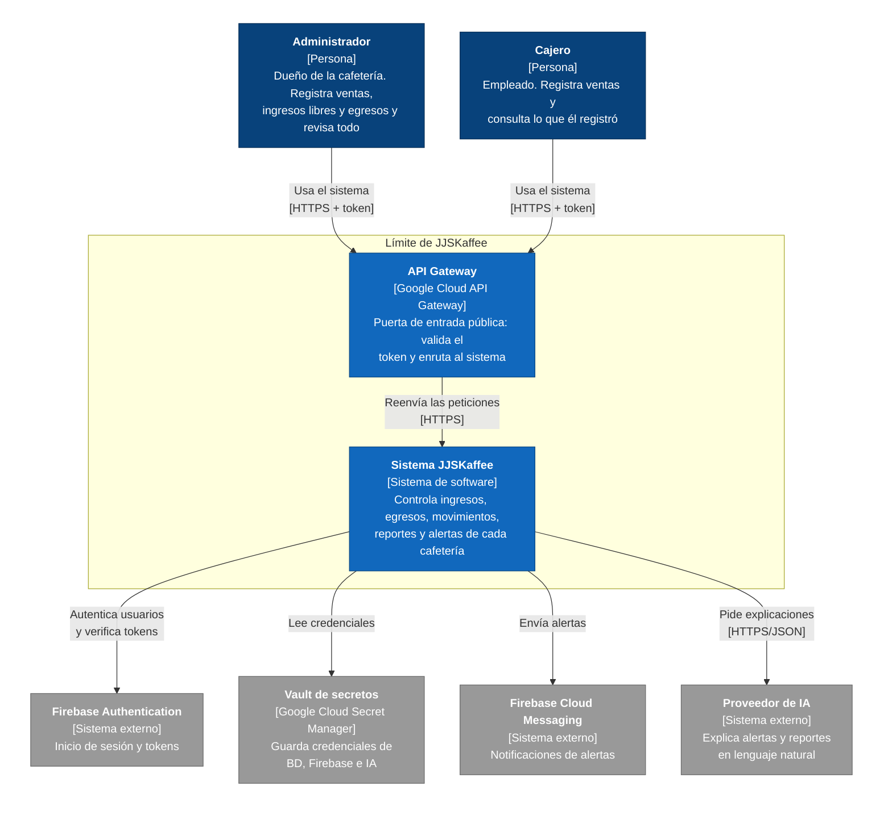
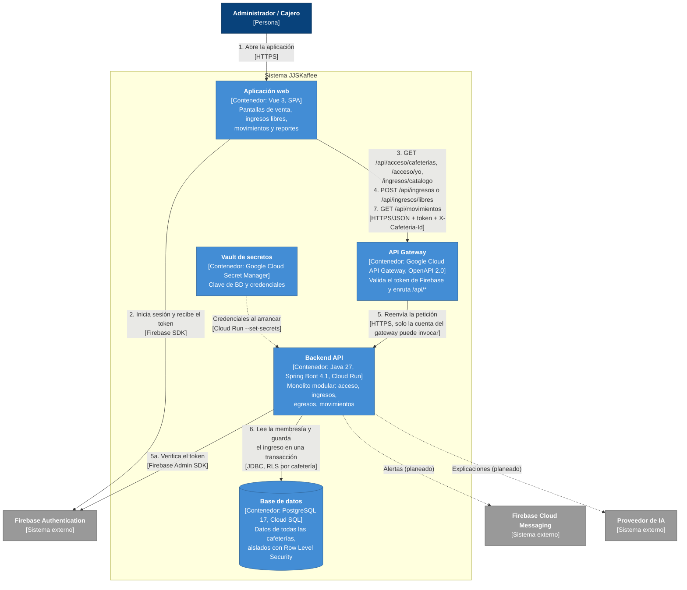

# Diseño de alto nivel

Este documento muestra el sistema JJSKaffee desde afuera (nivel 1 del modelo C4) y los contenedores que lo forman (nivel 2). El nivel 2 sigue el recorrido de **registrar ingreso**, que es la funcionalidad a mi cargo, para que se vea por qué contenedores pasa una petición y dónde queda la evidencia en el código.

El detalle de cada contenedor está en el diseño detallado:
[componentes](02-diagrama-componentes.md) · [paquetes](03-diagrama-paquetes.md) · [secuencia](04-diagrama-secuencia.md) · [despliegue](05-diagrama-despliegue.md).

## 1. Qué es el sistema

JJSKaffee es un sistema web SaaS para que cafeterías pequeñas e independientes de Colombia controlen sus ingresos y egresos, con reportes, comparaciones entre períodos y alertas. Es **multi-tenant**: varias cafeterías comparten la misma base de datos y cada una solo ve lo suyo. Una persona puede pertenecer a varias cafeterías, con un rol distinto en cada una (ADR-0016).

| Rol | Qué hace en registrar ingreso |
|---|---|
| Administrador | Registra ventas e ingresos libres (monto + categoría) y ve todos los movimientos de la cafetería |
| Cajero | Registra ventas y solo ve lo que él registró |

## 2. Lo que guía el diseño

Los atributos de calidad salen de la priorización por rol ([`calidad/priorizacion-y-escenarios-qa.md`](../calidad/priorizacion-y-escenarios-qa.md)). Estos son los que más pesan y cómo los atiende el diseño:

| Atributo | Peso | Meta | Cómo lo atiende el diseño | ADR |
|---|---|---|---|---|
| Seguridad | 14,4 % | 0 % de fugas de datos entre cafeterías; el cajero no entra a funciones del administrador | Row Level Security forzado en PostgreSQL, usuario de BD limitado, rol por membresía revisado en cada petición, API Gateway y vault de secretos | 0001, 0012, 0014, 0016, 0017 |
| Rendimiento | 14,4 % | Registrar una venta en 1 a 2 s (máximo 3 s); consultar movimientos en máximo 4 s | Totales con SQL (`SUM ... FILTER`), índices por cafetería y fecha, consultas paginadas | 0004 |
| Capacidad | 13,6 % | Más de 10.000 movimientos al año por cafetería; 50 categorías | Categorías como tabla propia por cafetería; paginación | 0003, 0004 |
| Usabilidad | 12,9 % | Venta en menos de 5 s y 3 clics; corregir en menos de 2 pasos | El servidor calcula el total; deshacer venta en 60 s; catálogo listo para la pantalla de venta | 0008, 0009 |
| Disponibilidad | 11,4 % | 99 % en el horario de la cafetería | Backend sin estado en Cloud Run (reinicio automático y varias instancias) | 0005, 0006, 0013 |
| Auditoría | 3,0 % | 100 % de movimientos con usuario, fecha y hora | Usuario, cafetería y fecha los pone el servidor, nunca el cliente | 0007 |

## 3. Estilo de arquitectura

- **Monolito modular sin estado** (ADR-0006 y ADR-0015). Es una sola aplicación Spring Boot, que se despliega como un solo servicio, dividida en módulos de negocio: `compartido`, `acceso`, `ingresos`, `egresos` y `movimientos`. Inventario, nómina, reportes y alertas se agregan como módulos nuevos.
- **Cada módulo es una arquitectura hexagonal**: `dominio` (reglas en Java puro), `servicios` (casos de uso y puertos) e `infraestructura` (adaptadores HTTP, JDBC y Firebase). ArchUnit lo verifica en cada `build`.
- **Multi-tenant con una base de datos compartida**, aislada por `id_cafeteria` con Row Level Security (ADR-0012).
- **Servicios administrados** para lo que no es diferencial: autenticación y notificaciones con Firebase, IA con un proveedor externo, secretos con Secret Manager y entrada pública con API Gateway (ADR-0011, ADR-0013, ADR-0014, ADR-0017).

## 4. C4 nivel 1: contexto

El nivel 1 muestra el sistema como una caja, con las personas que lo usan y los sistemas externos. Por pedido del profesor también aparecen el **API Gateway**, que es la única puerta de entrada, y el **vault de secretos**.

| Elemento | Tipo | Responsabilidad |
|---|---|---|
| Administrador y Cajero | Personas | Usan el sistema desde el navegador de la cafetería (Chrome, Firefox o Edge) |
| API Gateway | Parte de JJSKaffee | Única entrada pública. Revisa la firma del token con las llaves públicas de Firebase y rechaza peticiones sin token válido antes de que lleguen al sistema |
| Sistema JJSKaffee | Sistema propio | Toda la lógica de negocio y los datos de las cafeterías |
| Firebase Authentication | Externo | Maneja usuarios y contraseñas; el sistema nunca guarda contraseñas (ADR-0001) |
| Firebase Cloud Messaging | Externo | Envía las alertas al navegador del administrador (ADR-0005) |
| Proveedor de IA | Externo | Explica alertas y reportes; si falla, las alertas por reglas siguen funcionando (ADR-0011) |
| Vault de secretos | Externo administrado | Guarda las credenciales fuera del código (ADR-0014) |

## 5. C4 nivel 2: contenedores

El nivel 2 abre la caja del sistema. Las flechas numeradas siguen **registrar ingreso**, desde que la persona inicia sesión hasta que ve el ingreso en sus movimientos.

### Contenedores

| Contenedor | Tecnología | Responsabilidad | Estado |
|---|---|---|---|
| Aplicación web | Vue 3, Firebase SDK web | Pantallas por rol; manda el token y `X-Cafeteria-Id` en cada petición. Ocultar botones no basta: el backend valida todo | Estructura base hecha en `jjskaffee-frontend` (rutas por permiso, sesión, cliente HTTP, stores y api de los cuatro módulos); pantallas por construir |
| API Gateway | Google Cloud API Gateway con un archivo OpenAPI 2.0 | Expone `/api/*`, valida el token de Firebase y llama al backend con su propia cuenta de servicio | Diseñado (ADR-0017) |
| Backend API | Java 27, Spring Boot 4.1, JDBC, Firebase Admin | Reglas de negocio, permisos por rol, transacciones y trazabilidad | **Implementado**: 216 pruebas, CI en verde |
| Base de datos | PostgreSQL 17 (local) / Cloud SQL (nube) | Guarda cafeterías, membresías, catálogo, ventas, ingresos libres y egresos con RLS forzado | **Implementada**: scripts `db/01` a `db/10` |
| Vault de secretos | Google Cloud Secret Manager | Guarda la clave de la BD y las credenciales; Cloud Run las entrega al backend como variables de entorno | Diseñado (ADR-0014). En local los secretos salen de `.env` |

### Trazabilidad de registrar ingreso

| Paso | Qué pasa | Contenedor | Dónde se ve en el código |
|---|---|---|---|
| 1–2 | La persona inicia sesión y obtiene el token de Firebase | Aplicación web, Firebase Authentication | — (frontend) |
| 3 | Ve sus cafeterías con su rol, elige una y carga el menú y el catálogo | Backend API | `AccesoController`, `ConsultarAcceso`, `IngresosController.catalogo` |
| 4 | Registra una venta o un ingreso libre | Aplicación web → API Gateway | `IngresosController` (`POST /ingresos`, `POST /ingresos/libres`) |
| 5 | El gateway reenvía; el backend verifica el token, lee `X-Cafeteria-Id` y busca la membresía | API Gateway, Backend API | `FirebaseAuthFilter`, `AutenticarUsuario`, `FirebaseAuthAdapter` |
| 6 | El caso de uso valida, calcula el total y guarda todo o nada con la cafetería fijada para RLS | Backend API, Base de datos | `RegistrarIngreso`, `RegistrarIngresoLibre`, `PgUnidadDeTrabajo`, `PgVentaRepository` |
| 7 | El ingreso aparece en los movimientos con los totales del filtro | Backend API, Base de datos | `ConsultarMovimientos`, `PgMovimientoRepository` (vista `v_movimiento`) |

La prueba `FlujoRegistrarIngresoIT` recorre los pasos 3 a 7 por HTTP contra PostgreSQL.

### Trazabilidad de requisitos

| Requisito | Contenedores | Componentes | Prueba |
|---|---|---|---|
| RF7, RF9: varias cafeterías y aislamiento | Backend API, Base de datos | `FirebaseAuthFilter`, `PgUnidadDeTrabajo`, políticas RLS | `MultiCafeteriaIT`, `AislamientoEntreCafeteriasIT` |
| RF24–RF27: venta con productos y adiciones | Backend API, Base de datos | `RegistrarIngreso`, `Venta`, `PgVentaRepository` | `VentaTest`, `RegistrarIngresoTest`, `RegistrarIngresoValidacionesIT` |
| Ingreso libre (solo administrador) | Backend API, Base de datos | `RegistrarIngresoLibre`, `IngresoLibre`, `PgIngresoLibreRepository` | `IngresoLibreTest`, `IngresosLibresIT` |
| RF38: consultar movimientos con totales | Backend API, Base de datos | `ConsultarMovimientos`, `PgMovimientoRepository` | `ConsultarMovimientosTest`, `MovimientosControllerIT` |
| RF40: permisos por rol | Backend API | `Rol.permisos()`, `UsuarioAutenticado` | `RolTest`, `FlujoRegistrarIngresoIT` |
| ADR-0002: todo o nada | Base de datos | `PgUnidadDeTrabajo` | `TransaccionTodoONadaIT` |

## 6. Decisiones que sostienen este diseño

| ADR | Decisión |
|---|---|
| [0001](../adr/adr-0001.md) | Autenticación con Firebase Authentication |
| [0002](../adr/adr-0002.md) | Cada movimiento en una transacción |
| [0004](../adr/adr-0004.md) | Totales con SQL e índices |
| [0006](../adr/adr-0006.md) | Monolito sin estado |
| [0007](../adr/adr-0007.md) | Usuario y fecha los pone el servidor |
| [0012](../adr/adr-0012.md) | PostgreSQL por Row Level Security |
| [0013](../adr/adr-0013.md) | Google Cloud Platform |
| [0014](../adr/adr-0014.md) | Vault de secretos con Secret Manager |
| [0015](../adr/adr-0015.md) | Monolito modular con módulos hexagonales |
| [0016](../adr/adr-0016.md) | Cafetería por encabezado y rol por membresía |
| [0017](../adr/adr-0017.md) | API Gateway de Google Cloud delante de Cloud Run |
