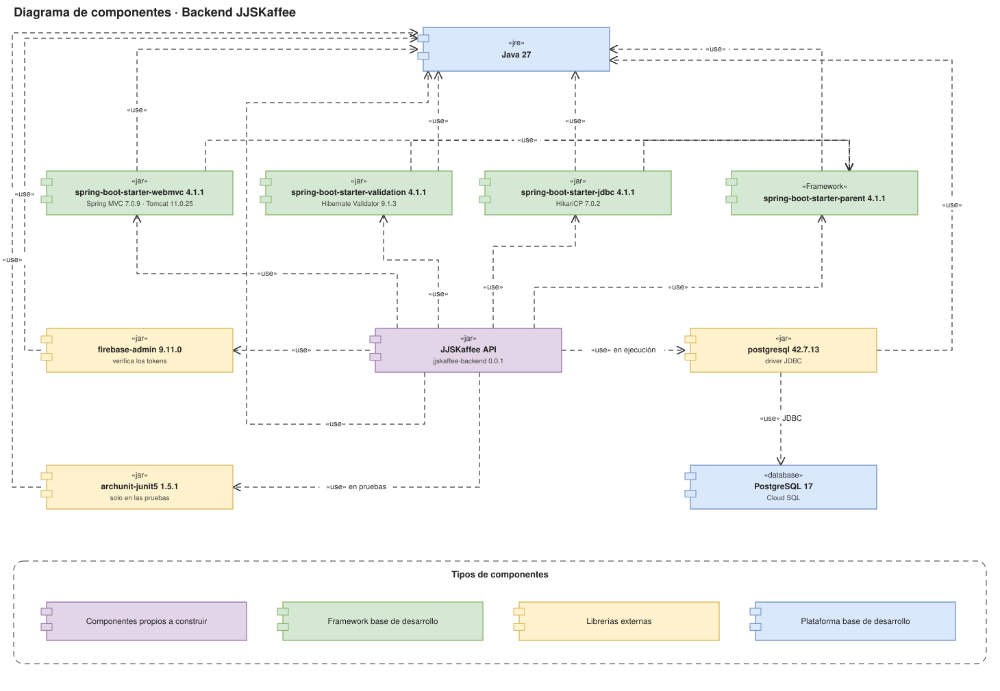

# Diagrama de componentes

El diagrama muestra los **componentes de software** con los que se construye y se ejecuta el backend de JJSKaffee, y cómo dependen unos de otros (`«use»`). Sigue la notación que dio el profesor: cada caja es un componente con su estereotipo (`«jar»`, `«Framework»`, `«jre»`, `«database»`) y su versión, y el color dice de qué tipo es.

Archivo para editar: [`img/componentes-backend.drawio`](img/componentes-backend.drawio), en [app.diagrams.net](https://app.diagrams.net). La imagen `.drawio.svg` también se puede abrir y editar ahí.

## Tipos de componentes

| Color | Tipo | Componentes |
|---|---|---|
| Morado | Componentes propios a construir | JJSKaffee API |
| Verde | Framework base de desarrollo | Spring Boot 4.1.1: `spring-boot-starter-parent`, `-webmvc`, `-validation` y `-jdbc` |
| Amarillo | Librerías externas | `firebase-admin`, `postgresql` (driver JDBC) y `archunit-junit5` |
| Azul | Plataforma base de desarrollo | Java 27 y PostgreSQL 17 |

## Componentes

| Componente | Versión | Para qué lo usa el proyecto | Decisión |
|---|---|---|---|
| **JJSKaffee API** | 0.0.1 | El backend propio: un solo jar con los módulos `acceso`, `ingresos`, `egresos` y `movimientos`, cada uno con arquitectura hexagonal | ADR-0006, ADR-0015 |
| `spring-boot-starter-parent` | 4.1.1 | Framework base: fija las versiones de todas las dependencias de Spring y la configuración de compilación | — |
| `spring-boot-starter-webmvc` | 4.1.1 | API REST (controllers y filtros) con Spring MVC 7.0.9 sobre Tomcat 11.0.25 | — |
| `spring-boot-starter-validation` | 4.1.1 | Valida los DTO de entrada (`@Valid`, `@Digits`…) con Hibernate Validator 9.1.3 | — |
| `spring-boot-starter-jdbc` | 4.1.1 | Acceso a datos con `JdbcTemplate`, transacciones y el pool de conexiones HikariCP 7.0.2. Sin JPA, que ArchUnit prohíbe | ADR-0002, ADR-0015 |
| `firebase-admin` | 9.11.0 | Verifica los tokens de Firebase Authentication en `FirebaseAuthAdapter` | ADR-0001 |
| `postgresql` | 42.7.13 | Driver JDBC. Solo se necesita en ejecución (`scope runtime`) | ADR-0012 |
| `archunit-junit5` | 1.5.1 | Pruebas que verifican la arquitectura (`ArquitecturaTest`). Solo en las pruebas (`scope test`) | ADR-0015 |
| Java | 27 | Plataforma en la que corre todo | — |
| PostgreSQL | 17 | Base de datos con Row Level Security; en la nube, Cloud SQL | ADR-0012, ADR-0013 |

Las versiones salen del `pom.xml` del backend. Las que no están escritas ahí, como la del driver de PostgreSQL o HikariCP, las fija Spring Boot 4.1.1. Tomcat (11.0.25) y Jackson (3.1.7) se fuerzan en el `pom.xml` a versiones más nuevas que las de Spring Boot, porque Trivy reportó vulnerabilidades en las anteriores.

## Cómo se leen las dependencias

- **Todo usa Java 27**: el backend, los starters, el parent y las librerías externas corren sobre la misma plataforma.
- **Los starters usan el parent**: `spring-boot-starter-parent` define las versiones de webmvc, validation y jdbc, para que sean compatibles entre sí.
- **El backend usa** el parent, los tres starters, `firebase-admin`, el driver de PostgreSQL (`«use» en ejecución`) y ArchUnit (`«use» en pruebas`).
- **El driver usa la base de datos**: `postgresql` se conecta por JDBC a PostgreSQL 17.

## Qué no aparece y dónde está

- **Firebase Authentication, Secret Manager, API Gateway y Cloud Run** son servicios en la nube, no componentes que se empaquetan con el backend. Están en el [diagrama de despliegue](05-diagrama-despliegue.md) y en el [C4 nivel 2](01-diseno-alto-nivel.md#5-c4-nivel-2-contenedores).
- **Los módulos y clases internas** del JJSKaffee API (controllers, casos de uso, repositorios) están en el [diagrama de paquetes](03-diagrama-paquetes.md) y en el [diagrama de secuencia](04-diagrama-secuencia.md).
- **La aplicación web en Vue** es un cliente aparte, con sus propias dependencias en el `package.json` de `jjskaffee-frontend` (Vue, Vue Router, Pinia y el SDK web de Firebase). Este diagrama es el del backend; los paquetes del frontend están en el [diagrama de paquetes](03-diagrama-paquetes.md#2-frontend-vue-3--typescript).
