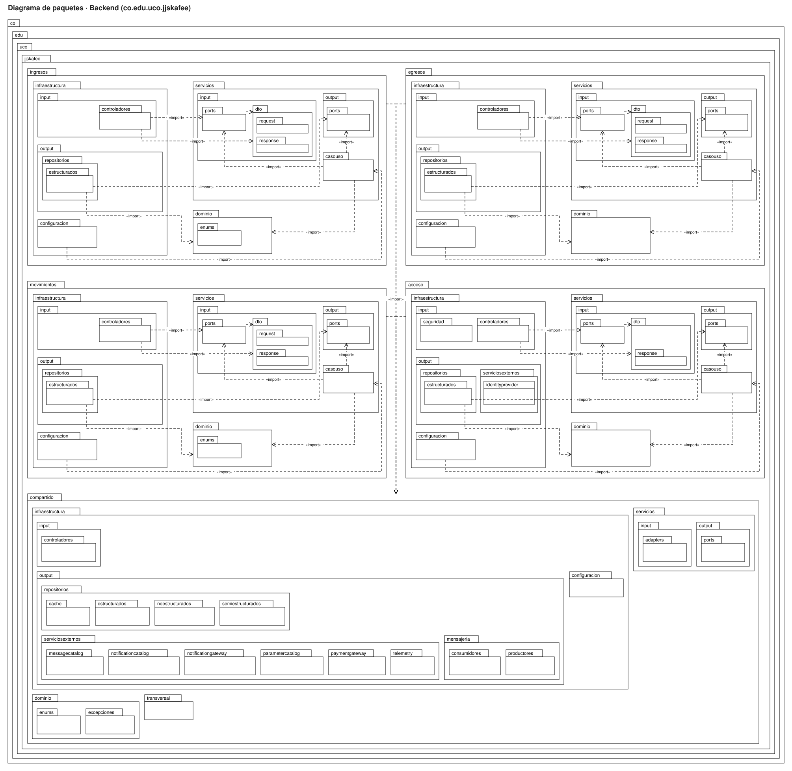
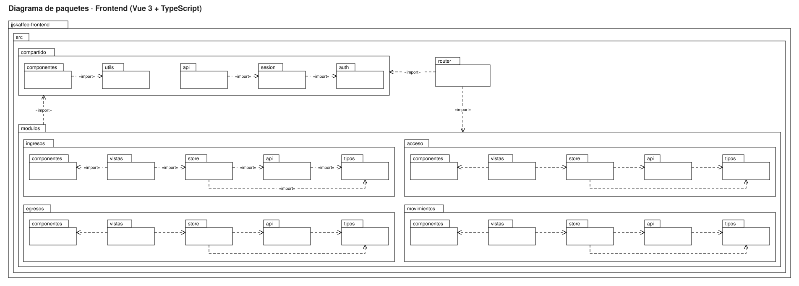
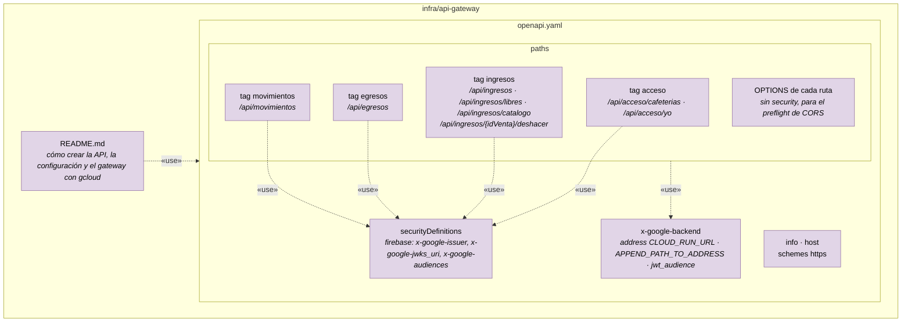

# Diagrama de paquetes

Los diagramas de paquetes siguen la forma que dio el profesor:

- Cada paquete es una **carpeta UML** (pestaña con el nombre y cuerpo), y los paquetes que están dentro de otro se dibujan anidados.
- Las flechas punteadas **`«import»`** muestran qué paquete usa clases de otro. Van del que importa al importado: por ejemplo, `controladores` importa `ports` y `dto`.

El backend y el frontend se organizan por los **mismos módulos de negocio**: `acceso`, `ingresos`, `egresos` y `movimientos`, más un paquete `compartido`. En los dos diagramas, `ingresos` (mi funcionalidad) va primero.

Los diagramas están hechos en draw.io: [`img/paquetes-backend.drawio`](img/paquetes-backend.drawio) y [`img/paquetes-frontend.drawio`](img/paquetes-frontend.drawio) se abren y se editan en [app.diagrams.net](https://app.diagrams.net). Cada paquete es un contenedor, así que al mover uno se mueve con todo lo que tiene adentro. Las imágenes `.drawio.svg` también se pueden editar ahí.

## 1. Backend (Java · Spring Boot)

El paquete raíz es `co.edu.uco.jjskafee`. Dentro están los cinco módulos y, dentro de cada módulo, las capas de la arquitectura hexagonal: `infraestructura`, `servicios` y `dominio`. El diagrama tiene **todos** los paquetes del código, sacados del repositorio.

Las flechas `«import»` salen de los `import` reales del código. En cada módulo se dibujan las dependencias que definen la arquitectura hexagonal; todas van **hacia adentro**, de `infraestructura` a `servicios` y de `servicios` a `dominio`:

| De | A | Por qué |
|---|---|---|
| `infraestructura.input.controladores` | `servicios.input.ports` y `servicios.input.dto` | El controller llama al caso de uso por su interfaz y le pasa los DTO |
| `servicios.input.ports` | `servicios.input.dto` | La interfaz del caso de uso recibe y devuelve DTO |
| `servicios.casouso` | `servicios.input.ports` | El caso de uso implementa su puerto de entrada |
| `servicios.casouso` | `servicios.output.ports` y `dominio` | Usa los repositorios por su interfaz y las reglas del dominio |
| `infraestructura.output.repositorios.estructurados` | `servicios.output.ports` y `dominio` | El repositorio JDBC implementa el puerto de salida y arma las entidades |
| `infraestructura.configuracion` | `servicios.casouso` | Crea los casos de uso y les pasa los adaptadores |
| Cada módulo | `compartido` | Usa `UsuarioAutenticado`, las excepciones, `UnidadDeTrabajo` y los encabezados |

Ningún módulo importa a otro módulo, y nada importa `infraestructura`. Eso es lo que verifica ArchUnit (tabla de abajo).



### Los módulos

| Paquete | Qué contiene |
|---|---|
| `compartido` | Lo que usan todos: `UsuarioAutenticado`, `Rol`, `Permiso`, `Producto`, `Categoria`, las excepciones, `UnidadDeTrabajo`, `CatalogoRepository`, `ManejadorDeErrores`, `CorsConfig` y los encabezados (`X-Cafeteria-Id`, `Idempotency-Key`) |
| `acceso` | Identidad, cafeterías de la persona y rol por membresía |
| `ingresos` | Ventas, ingresos libres y catálogo de la pantalla de venta |
| `egresos` | Registro de egresos (solo se movió de paquete, la lógica no cambió) |
| `movimientos` | Consulta de ingresos y egresos con filtros, paginación y totales |

### Las capas dentro de cada módulo

| Paquete | Qué contiene | Ejemplo en `ingresos` |
|---|---|---|
| `infraestructura.input` | Adaptadores de entrada: controllers y filtros HTTP | `IngresosController` |
| `infraestructura.output` | Adaptadores de salida: repositorios JDBC (`repositorios.estructurados`) y servicios externos | `PgVentaRepository` |
| `infraestructura.configuracion` | Crea los casos de uso y los adaptadores del módulo | `IngresosConfig` |
| `servicios.input.ports` | Puertos de entrada (interfaces de los casos de uso) | `RegistrarIngresoUseCase` |
| `servicios.input.dto.request` / `response` | Datos que entran y salen por la API | `IngresoRequest`, `IngresoResponse` |
| `servicios.output.ports` | Puertos de salida (interfaces de los repositorios) | `VentaRepository` |
| `servicios.casouso` | Casos de uso en Java puro | `RegistrarIngreso` |
| `dominio` (y `dominio.enums`) | Entidades y reglas de negocio en Java puro | `Venta`, `EstadoVenta` |

`compartido` sigue la misma plantilla y además tiene los paquetes **reservados** para lo que viene (`repositorios.cache`, `serviciosexternos.telemetry`, `notificationgateway`, `mensajeria`, `servicios.input.adapters`, `transversal`…). Tienen un `.gitkeep` y todavía no tienen clases.

### Reglas que verifica ArchUnit

| # | Regla | Regla en `ArquitecturaTest` |
|---|---|---|
| 1 | Nadie usa `infraestructura`; `servicios` solo lo usa `infraestructura`; `dominio` solo lo usan `servicios` e `infraestructura` | `capasRespetanArquitecturaHexagonal` |
| 2 | El dominio no depende de Spring, JPA ni servlets | regla del dominio puro |
| 3 | Los servicios no dependen de Spring, `java.sql` ni Firebase | reglas de servicios |
| 4 | `infraestructura.input` no usa `infraestructura.output` ni `servicios.casouso` | regla de adaptadores de entrada |
| 5 | Todo lo que está en `input.ports` y `output.ports` es interfaz | `puertosSonInterfaces` |
| 6 | Sin JPA en ningún lado | regla sin `jakarta.persistence` |
| 7 | Un módulo solo usa de otro su `servicios.input` | `modulosSoloSeUsanPorSusPuertosDeEntrada` |
| 8 | `compartido` no depende de ningún módulo | regla de `compartido` |
| 9 | Sin ciclos entre módulos ni entre paquetes | `sinCiclosEntreModulos`, `sinCiclosEntrePaquetes` |

Si un cambio rompe una de estas reglas, se corrige el cambio, no la regla (ADR-0015).

## 2. Frontend (Vue 3 · TypeScript)

El repositorio `jjskaffee-frontend` ya tiene la estructura base: Vue 3 con TypeScript, Vite, Vue Router, Pinia y el SDK web de Firebase. Igual que el backend, se organiza **por módulo de negocio** y no por tipo de archivo, y cada módulo tiene las mismas cinco carpetas: `vistas`, `componentes`, `store`, `api` y `tipos`. Los paquetes del diagrama son las carpetas reales de `src/`.



Las flechas `«import»` salen de los `import` del código:

| De | A | Por qué | Ejemplo en `ingresos` |
|---|---|---|---|
| `vistas` | `store` y `componentes` | La pantalla muestra datos y llama acciones de su store; arma la interfaz con sus componentes | `VentaView.vue` → `ventaStore` |
| `store` | `api` y `tipos` | El store guarda el estado de la pantalla y pide los datos a su api | `ventaStore` → `ingresosApi` |
| `api` | `tipos` | Cada función de la api recibe y devuelve los tipos que reflejan los DTO del backend | `ingresosApi.registrarVenta(VentaRequest): Venta` |
| `modulos` | `compartido` | La api usa `clienteHttp`; los stores usan `sesion` y `utils` | `ingresosApi` → `clienteHttp` |
| `compartido.api` | `compartido.sesion` | `clienteHttp` toma de la sesión el token y la cafetería elegida, y cierra la sesión si el backend responde 401 | |
| `compartido.sesion` | `compartido.auth` | `sesionStore` inicia y cierra sesión con Firebase Authentication | |
| `compartido.componentes` | `compartido.utils` | `MontoDinero` muestra los valores en pesos colombianos | |
| `router` | `compartido` y `modulos` | Antes de abrir una pantalla, la guarda revisa la sesión, la cafetería elegida y el permiso; luego carga la vista del módulo | |

Ningún módulo importa a otro módulo y `compartido` no importa ningún módulo. Así un módulo se puede cambiar sin tocar los demás, igual que en el backend.

### Qué hay en cada carpeta

```text
jjskaffee-frontend/src
├── main.ts · App.vue            (arranque; barra de navegación según los permisos del rol)
├── router/index.ts              (rutas; la guarda revisa sesión, cafetería elegida y permiso)
├── compartido/
│   ├── api/clienteHttp.ts       (único que hace peticiones: Authorization, X-Cafeteria-Id, Idempotency-Key; ProblemDetail → ErrorApi)
│   ├── sesion/                  (sesionStore: persona, cafetería elegida, rol y permisos de GET /acceso/yo)
│   ├── auth/firebase.ts         (inicio y cierre de sesión con Firebase Authentication)
│   ├── componentes/             (MensajeAviso, MontoDinero)
│   └── utils/formato.ts         (pesos colombianos y fechas en hora de Colombia)
└── modulos/
    ├── acceso/                  (LoginView, ElegirCafeteriaView · accesoStore · accesoApi)
    ├── ingresos/                (VentaView, IngresoLibreView · ventaStore · ingresosApi)
    ├── egresos/                 (EgresoView · egresosStore · egresosApi)
    └── movimientos/             (MovimientosView · movimientosStore · movimientosApi)
```

| Módulo | Pantallas | Endpoints que usa su `api` |
|---|---|---|
| `acceso` | Iniciar sesión, elegir cafetería | `GET /acceso/cafeterias`, `GET /acceso/yo` |
| `ingresos` | Registrar venta, registrar ingreso libre | `GET /ingresos/catalogo`, `POST /ingresos`, `POST /ingresos/{idVenta}/deshacer`, `POST /ingresos/libres` |
| `egresos` | Registrar egreso | `POST /egresos` |
| `movimientos` | Listado con filtros y totales | `GET /movimientos` |

Las pantallas todavía son borradores; la estructura, el cliente HTTP, la sesión, las rutas por permiso y los stores y api de los cuatro módulos ya están hechos y probados.

### Reglas del frontend

Las reglas 1 a 3 las verifica ESLint (`no-restricted-imports` y `no-restricted-globals` en `eslint.config.ts`), igual que ArchUnit en el backend: si un cambio las rompe, `npm run lint` falla.

| # | Regla | Por qué |
|---|---|---|
| 1 | Un módulo no importa nada de otro módulo; lo común va a `compartido` | Módulos independientes, igual que en el backend |
| 2 | `compartido` no importa ningún módulo | Lo común no depende de lo particular |
| 3 | Solo `compartido/api/clienteHttp.ts` usa `fetch` | El token, `X-Cafeteria-Id` y el manejo de errores están en un solo lugar |
| 4 | Las vistas usan su `store`, el `store` usa su `api` y la `api` usa sus `tipos` | Una sola forma de hablar con el backend por módulo |
| 5 | Registrar venta o ingreso libre siempre lleva `Idempotency-Key` | Si la red falla y se reintenta, el backend no duplica el registro |
| 6 | Cafetería, usuario y fecha nunca van en el cuerpo de la petición | Los pone el backend a partir del token y de `X-Cafeteria-Id` |
| 7 | Ocultar un botón no es seguridad: el backend vuelve a revisar el permiso | Alguien podría llamar la API a mano |
| 8 | Ningún secreto en el código; la configuración va en variables `VITE_*` (`.env.local`, que no se sube) | La configuración web de Firebase es pública; las credenciales de verdad están en Secret Manager |

En local, Vite reenvía `/api/...` al backend (`http://localhost:8080`) quitando el prefijo `/api`, igual que lo hace el API Gateway en la nube.

## 3. API Gateway

El gateway no tiene código: es un archivo **OpenAPI 2.0** (`infra/api-gateway/openapi.yaml`, en el repositorio del backend) que Google Cloud API Gateway lee. Sus "paquetes" son las secciones de ese archivo, y las rutas se agrupan con `tags` por módulo, igual que en el backend.



| Sección | Qué contiene | Decisión |
|---|---|---|
| `securityDefinitions.firebase` | Emisor `https://securetoken.google.com/jjskafee`, llaves públicas de Google y audiencia `jjskafee` | El gateway rechaza tokens falsos antes de llegar al backend (ADR-0017) |
| `x-google-backend` | URL de Cloud Run, `path_translation: APPEND_PATH_TO_ADDRESS` y `jwt_audience` | El gateway llama a Cloud Run con su propia cuenta y reenvía el token original en `X-Forwarded-Authorization` |
| `paths` con `tags` | Una ruta por endpoint del backend, escrita completa con `/api`, agrupadas por módulo | Cada endpoint nuevo del backend se agrega aquí; si no, no se puede usar desde afuera |
| `OPTIONS` | Una operación sin seguridad por ruta | Deja pasar el preflight de CORS hasta el backend |

### Reglas del gateway

| # | Regla |
|---|---|
| 1 | Toda ruta, salvo `OPTIONS`, exige `security: firebase` |
| 2 | Las rutas del gateway son las del backend con el prefijo `/api`; no se renombran ni se combinan |
| 3 | El gateway no tiene lógica de negocio: valida el token y enruta. Los permisos por rol y la cafetería los revisa el backend |
| 4 | Encabezados propios (`X-Cafeteria-Id`, `Idempotency-Key`) pasan sin cambios |

## 4. Cómo se corresponden los módulos

| Módulo | Frontend (`src/modulos/...`) | API Gateway (`paths`) | Backend (`co.edu.uco.jjskafee...`) |
|---|---|---|---|
| acceso | `acceso`: inicio de sesión y elegir cafetería | `/api/acceso/cafeterias`, `/api/acceso/yo` | `acceso.infraestructura.input.controladores.AccesoController` |
| ingresos | `ingresos`: pantalla de venta e ingreso libre | `/api/ingresos`, `/api/ingresos/libres`, `/api/ingresos/catalogo`, `/api/ingresos/{idVenta}/deshacer` | `ingresos.infraestructura.input.controladores.IngresosController` |
| egresos | `egresos`: registrar egreso | `/api/egresos` | `egresos.infraestructura.input.controladores.EgresosController` |
| movimientos | `movimientos`: listado con filtros y totales | `/api/movimientos` | `movimientos.infraestructura.input.controladores.MovimientosController` |
| compartido | `compartido`: cliente HTTP, sesión, componentes | `securityDefinitions`, `x-google-backend` | `compartido` |
