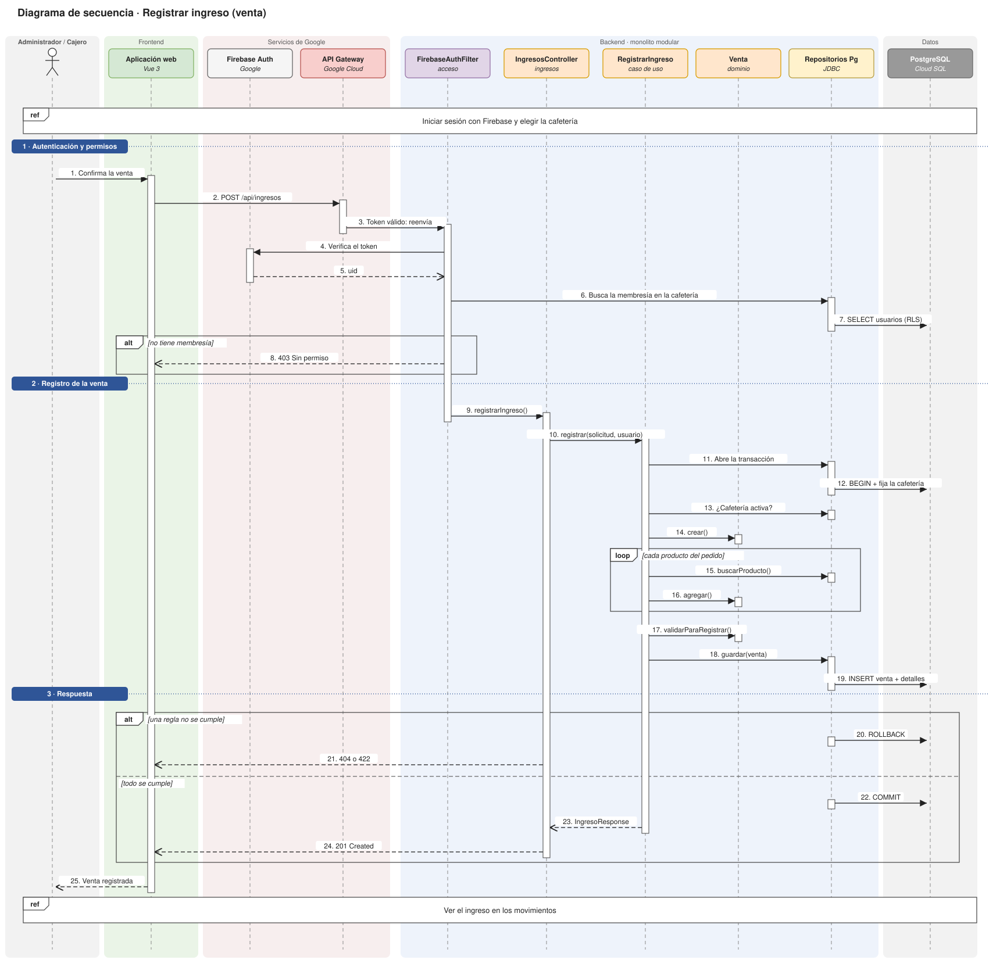

# Diagrama de secuencia: registrar ingreso

El diagrama de secuencia es de una sola funcionalidad, **registrar ingreso**, que es la que está a mi cargo. Muestra cómo viaja una venta por todas las piezas del proyecto, desde que la persona la confirma hasta que recibe la respuesta.

## Cómo leerlo

**Columnas.** Cada columna es un participante con su **línea de vida** (línea punteada vertical). Los fondos de color agrupan las piezas del proyecto, con los mismos colores del diagrama de componentes:

| Fondo | Pieza | Participantes |
|---|---|---|
| Verde | Frontend | Aplicación web (Vue 3) |
| Rojo claro | Servicios de Google | Firebase Auth y API Gateway |
| Azul claro | Backend (monolito modular) | `FirebaseAuthFilter` (módulo acceso); `IngresosController`, `RegistrarIngreso` y `Venta` (módulo ingresos); Repositorios Pg |
| Gris | Datos | PostgreSQL en Cloud SQL |

**Flechas.** La flecha llena es una **llamada** y la punteada es una **respuesta**. Los mensajes están numerados en el orden en que ocurren. Las **barras blancas** sobre las líneas de vida son **activaciones**: muestran cuándo está trabajando cada participante.

**Recuadros.** Son fragmentos de UML:
- `ref` nombra una interacción que no se dibuja aquí, para que el diagrama se enfoque en el registro.
- `alt` es una alternativa, con la condición entre corchetes.
- `loop` es una repetición.

## Las tres fases

**1 · Autenticación y permisos (pasos 1 a 8).**
1. La persona ya inició sesión y eligió la cafetería (`ref`).
2. Confirma la venta, y la aplicación web la envía al API Gateway con el token, la cafetería elegida (`X-Cafeteria-Id`) y una `Idempotency-Key`.
3. El gateway valida el token y reenvía la petición.
4. `FirebaseAuthFilter`, a través del caso de uso `AutenticarUsuario`, vuelve a verificar el token con Firebase y busca la membresía de la persona en esa cafetería, con Row Level Security.
5. Si no tiene membresía, responde **403**.

**2 · Registro de la venta (pasos 9 a 19).**
1. `IngresosController` le pasa la petición al caso de uso `RegistrarIngreso`.
2. El caso de uso abre una transacción con la cafetería fijada (`PgUnidadDeTrabajo`) y revisa que la cafetería esté activa.
3. Crea la `Venta` y, por cada producto (`loop`), lo busca en el catálogo y lo agrega.
4. Valida el total, que calcula el servidor, y guarda la venta con sus detalles.

**3 · Respuesta (pasos 20 a 25).**
- Si una regla no se cumple (`alt`), se hace **ROLLBACK**, no queda nada guardado y la respuesta es **404 o 422**.
- Si todo se cumple, se hace **COMMIT** y la respuesta es **201 Created**.
- La persona ve la confirmación y después puede ver el ingreso en los movimientos (`ref`).

El **ingreso libre**, que solo registra el administrador, sigue el mismo camino con `POST /api/ingresos/libres` y `RegistrarIngresoLibre`.

## Para exponerlo

1. **Empieza por los colores:** "estas son las cuatro piezas del proyecto: frontend, servicios de Google, backend y datos".
2. **Fase 1:** la seguridad va en dos capas. El gateway valida el token y el backend lo vuelve a verificar y revisa la membresía. Un cajero de otra cafetería recibe 403 y nunca llega al caso de uso.
3. **Fase 2:** todo pasa dentro de una transacción con la cafetería fijada para Row Level Security. Cada cafetería solo ve sus datos, y la venta se guarda completa o no se guarda.
4. **Fase 3:** el `alt` muestra las dos salidas, `ROLLBACK` con 404/422 o `COMMIT` con 201.

## Notas

- **Repositorios Pg** agrupa los adaptadores de base de datos: `PgUnidadDeTrabajo`, `PgUsuarioRepository`, `PgCafeteriaRepository`, `PgCatalogoRepository` y `PgVentaRepository`.
- **Respuestas:** vuelven por el API Gateway, pero se dibujan directo a la aplicación web para no repetir flechas.
- **Archivo para editar:** [`img/secuencia-registrar-ingreso.drawio`](img/secuencia-registrar-ingreso.drawio), en [app.diagrams.net](https://app.diagrams.net). La imagen `.drawio.svg` también se puede abrir y editar ahí.
