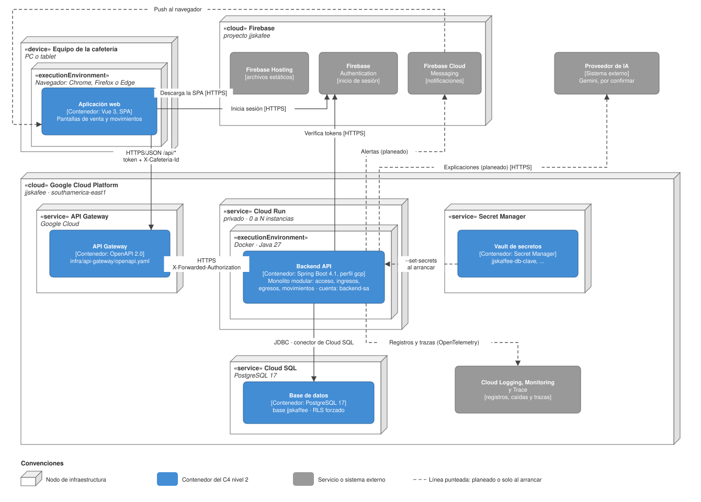
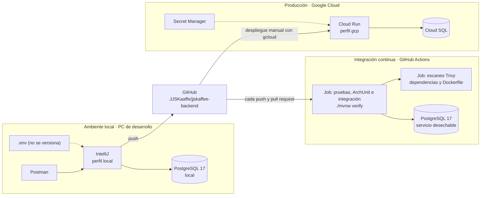

# Diagrama de despliegue

Este diagrama toma los contenedores del **modelo C4 nivel 2** ([diseño de alto nivel](01-diseno-alto-nivel.md#5-c4-nivel-2-contenedores)) y muestra en qué infraestructura corre cada uno. Los cubos son **nodos** (dónde corre), las cajas azules son los **contenedores** del nivel 2 (qué corre) y las grises son servicios o sistemas externos. Los nodos llevan su estereotipo UML: `«device»`, `«executionEnvironment»`, `«service»` y `«cloud»`.

Está hecho en draw.io: [`img/diagrama-de-despliegue.drawio`](img/diagrama-de-despliegue.drawio) se abre y se edita en [app.diagrams.net](https://app.diagrams.net), y la imagen de abajo (`img/diagrama-de-despliegue.drawio.svg`) también se puede editar ahí.

## 1. Producción en Google Cloud

La nube es Google Cloud Platform (ADR-0013). La región propuesta es `southamerica-east1` (São Paulo), la más cercana a Colombia con Cloud Run y Cloud SQL.

> Los nombres de este diagrama que todavía no existen en la nube (región, cuentas de servicio `gateway-invoker` y `backend-sa`, nombre del servicio y de los secretos, Firebase Hosting para el frontend) son **propuestos**. Se ajustan cuando se monte la nube.

### Nodos y lo que corre en cada uno

| Nodo | Contenedor del nivel 2 | Artefacto | Configuración | Estado |
|---|---|---|---|---|
| Equipo de la cafetería → Navegador | Aplicación web | Build de Vue servido por Firebase Hosting | Apunta a `https://<gateway>/api` | Pendiente: el frontend tiene la estructura base y todavía no se despliega |
| Google Cloud API Gateway | API Gateway | `infra/api-gateway/openapi.yaml` | Valida tokens de Firebase (`securetoken.google.com/jjskafee`); `OPTIONS` sin token para CORS | Diseñado (ADR-0017) |
| Cloud Run → Contenedor Docker | Backend API | Imagen Docker construida con el `Dockerfile` del repo y guardada en Artifact Registry | Perfil `gcp`, `context-path=/api`, solo la cuenta del gateway puede invocarlo | Diseñado; corre hoy en local |
| Cloud SQL | Base de datos | Scripts `db/01` a `db/10` | PostgreSQL 17, usuario limitado `app_jjskaffee`, `FORCE ROW LEVEL SECURITY` | Corre hoy en local y en el CI |
| Secret Manager | Vault de secretos | Un secreto por credencial | Lectura solo para `backend-sa` | Diseñado (ADR-0014) |
| Firebase | Externos | Proyecto `jjskafee` | Authentication activo; usuarios de prueba creados | Authentication en uso |
| Cloud Logging, Monitoring y Trace | — (servicio de la plataforma) | Registros de Cloud Run; trazas con OpenTelemetry | Reinicio automático y alertas de caída (ADR-0005); instrumentación con OpenTelemetry y MDC, como recomendó el profesor (paquete reservado `compartido.infraestructura.output.serviciosexternos.telemetry`) | Registros: automáticos al desplegar. Trazas: planeado |

### Seguridad del despliegue

- **Una sola puerta de entrada.** Cloud Run es privado: solo `gateway-invoker` tiene `roles/run.invoker`. Nadie puede saltarse el gateway.
- **Dos revisiones del token.** El gateway rechaza tokens falsos antes de que lleguen al backend, y el backend vuelve a verificar el token y la membresía (`FirebaseAuthFilter`).
- **Mínimo privilegio.** `backend-sa` solo puede leer sus secretos y conectarse a Cloud SQL. En la base, el backend usa `app_jjskaffee`, que no tiene `DELETE` ni es dueño de las tablas.
- **Ningún secreto en el repo ni en la imagen.** Cloud Run lee los secretos de Secret Manager al arrancar y los entrega como variables de entorno (`JJSKAFFEE_DB_CLAVE`, ...), que Spring toma en `application.properties`.
- **Hora en UTC.** El servidor guarda todo en UTC (`timestamptz` e `Instant`); la hora de Colombia solo se usa para interpretar los filtros de fechas.

## 2. Ambientes

El mismo artefacto, el jar del backend, corre en tres ambientes. Lo que cambia es de dónde salen la base y los secretos.

| Ambiente | Base de datos | Secretos | Cómo se llega | Para qué |
|---|---|---|---|---|
| Local | PostgreSQL 17 en el PC, scripts `db/01` a `db/10` en pgAdmin | Archivo `.env` | `http://localhost:8080` sin `/api` | Programar y probar con Postman y un usuario real de Firebase |
| CI | Contenedor PostgreSQL 17 que se crea y se borra en cada ejecución | Clave aleatoria enmascarada | No se expone | `./mvnw verify` (unitarias, ArchUnit, integración) y Trivy en cada push |
| Producción | Cloud SQL | Secret Manager | `https://<gateway>/api` | Uso real de las cafeterías |

La guía paso a paso para montar la nube queda en el [repositorio del backend](https://github.com/JJSKaaffe/jjskaffee-backend) (`docs/despliegue/gcp.md`, Fase 6).
