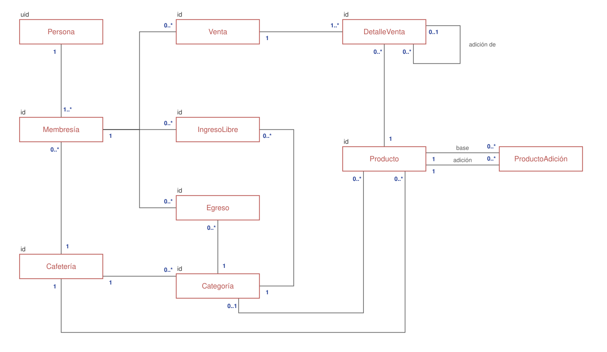
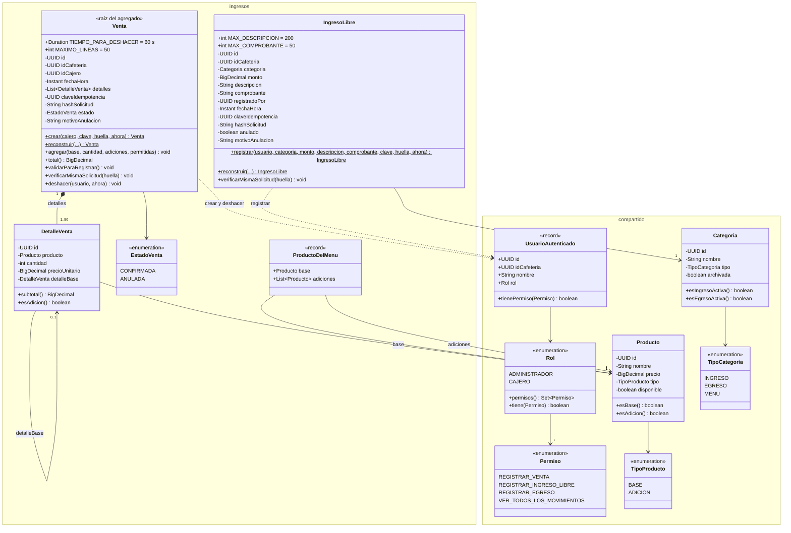
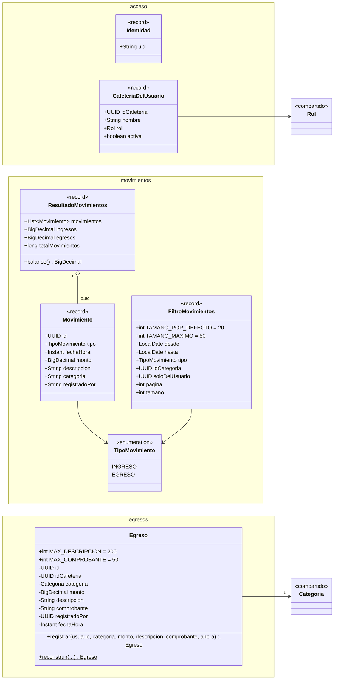

# Modelo de dominio

El modelo de dominio muestra los conceptos del negocio y cómo se relacionan, con su identificador (`id`) y las multiplicidades de cada relación. Está hecho en draw.io: el archivo [`img/modelo-de-dominio.drawio`](img/modelo-de-dominio.drawio) se abre y se edita en [app.diagrams.net](https://app.diagrams.net), y la imagen de abajo (`img/modelo-de-dominio.drawio.svg`) también se puede abrir y editar ahí.

## 1. Modelo de dominio

### Cómo leer las multiplicidades

| Relación | Se lee |
|---|---|
| Persona 1 — 1..* Membresía | Una persona tiene una o varias membresías; cada membresía es de una sola persona |
| Cafetería 1 — 0..* Membresía | Una cafetería tiene cero o varias membresías; cada membresía es de una sola cafetería |
| Membresía 1 — 0..* Venta | Quien tiene la membresía registra cero o varias ventas; cada venta la registra una sola membresía (`id_cajero`) |
| Membresía 1 — 0..* IngresoLibre | Igual para los ingresos libres (`registrado_por`) |
| Membresía 1 — 0..* Egreso | Igual para los egresos (`registrado_por`) |
| Venta 1 — 1..* DetalleVenta | Una venta tiene al menos un detalle (máximo 50); cada detalle es de una sola venta |
| Producto 1 — 0..* DetalleVenta | Un producto aparece en cero o varios detalles; cada detalle vende un solo producto |
| DetalleVenta 0..1 — 0..* DetalleVenta (adición de) | Una línea base puede tener varias adiciones; una adición pertenece a una sola línea base, y una línea base no pertenece a ninguna |
| Producto 1 — 0..* ProductoAdición (base y adición) | Dice qué adiciones permite cada producto base. Es la tabla intermedia de una relación de muchos a muchos entre productos |
| Cafetería 1 — 0..* Producto | El menú de cada cafetería |
| Cafetería 1 — 0..* Categoría | Las categorías de cada cafetería |
| Categoría 1 — 0..* IngresoLibre | Cada ingreso libre tiene una categoría de tipo INGRESO |
| Categoría 1 — 0..* Egreso | Cada egreso tiene una categoría de tipo EGRESO |
| Categoría 0..1 — 0..* Producto | Un producto puede tener una categoría del menú, o ninguna |

`ProductoAdición` no lleva `id` propio: se identifica por la pareja (producto base, adición). `Persona` se identifica por el `uid` de Firebase, porque el sistema no guarda usuarios ni contraseñas (ADR-0001).

Todo lo que cuelga de una cafetería (membresías, categorías, productos, ventas, ingresos y egresos) guarda también `id_cafeteria`, que es lo que usa el Row Level Security para aislar los datos (ADR-0012). No se dibuja como relación aparte porque ya se llega a la cafetería por la membresía o por el producto.

**Movimiento** no aparece porque no es una entidad que se guarde: es una vista (`v_movimiento`) que junta ventas confirmadas, ingresos libres y egresos para la consulta.

### Conceptos

| Concepto | Qué es en el negocio |
|---|---|
| Cafetería | El cliente del SaaS. Todo lo demás le pertenece a una cafetería y ninguna ve lo de otra |
| Persona | Quien inicia sesión. Solo se conoce su identidad de Firebase (`uid`) |
| Membresía | La relación de una persona con una cafetería, con su rol: administrador o cajero. Una persona puede tener varias, con un rol distinto en cada cafetería (ADR-0016) |
| Categoría | Clasifica ingresos libres, egresos y el menú. Cada cafetería tiene las suyas y se archivan, no se borran (ADR-0003) |
| Producto | Lo que se vende. Un producto **base** (un latte) puede llevar **adiciones** permitidas (leche de almendra) |
| Venta | Un ingreso por productos del menú. El total lo calcula el servidor |
| Detalle de venta | Cada línea de la venta, con el precio del momento. Una adición queda colgada de la línea base a la que pertenece |
| Ingreso libre | Un ingreso que no es una venta (por ejemplo, un alquiler o un aporte): monto + categoría. Solo lo registra el administrador |
| Egreso | Un gasto de la cafetería con su categoría. Solo lo registra el administrador |
| Movimiento | Vista de consulta que junta ventas confirmadas, ingresos libres y egresos para listarlos y sumar totales |

Los conceptos de inventario, nómina, reportes y alertas se agregan a este modelo cuando se construyan sus módulos.

## 2. Detalle: clases del dominio en el código

Esta sección baja el modelo al código: son las clases reales de los paquetes `dominio`, en Java puro, sin Spring ni base de datos (ADR-0015). Cada una valida sus reglas al crearse.

### 2.1 Ingresos (registrar ingreso) y `compartido`

Esta es la parte a mi cargo. `Venta` es la raíz de su agregado: los `DetalleVenta` solo se crean y se cambian a través de ella.

### 2.2 Acceso, egresos y movimientos

`Identidad` sale del token de Firebase; con ella y la cafetería elegida, el módulo `acceso` arma el `UsuarioAutenticado` de `compartido`, que es el que reciben todos los casos de uso.

## 3. Reglas del dominio

Cada regla la valida la clase indicada. Si no se cumple, lanza `ReglaNegocioException` (422) o `SinPermisoException` (403).

| Clase | Regla |
|---|---|
| `Venta` | Al menos un producto; máximo 50 líneas (cada base y cada adición distinta cuenta) |
| `Venta` | El producto base es de tipo `BASE` y está disponible; cada adición es `ADICION`, está disponible y está permitida para ese base |
| `Venta` | Precio > 0 y con máximo 2 decimales; cantidad entera de 1 a 99 |
| `Venta` | Total = Σ precio × cantidad, > 0 y con máximo 2 decimales, **sin redondear** |
| `Venta` | El precio unitario se copia al detalle al vender: si después cambia el menú, la venta no cambia |
| `Venta` | Deshacer: solo quien la registró, si no estaba anulada y dentro de 60 s (ADR-0008) |
| `Venta`, `IngresoLibre` | La misma `Idempotency-Key` con otro contenido se rechaza; clave y huella van siempre juntas |
| `IngresoLibre` | Solo con el permiso `REGISTRAR_INGRESO_LIBRE` (administrador) |
| `IngresoLibre` | Categoría de tipo `INGRESO` y no archivada; monto > 0, máximo 2 decimales y 10 dígitos enteros |
| `IngresoLibre`, `Egreso` | Descripción obligatoria de máximo 200 caracteres; comprobante opcional de máximo 50 |
| `Egreso` | Solo el administrador; categoría de tipo `EGRESO` y no archivada; monto > 0 |
| `ProductoDelMenu` | Solo contiene lo que `Venta` aceptaría: base y adiciones disponibles con precio > 0 |
| `FiltroMovimientos` | `desde` ≤ `hasta`; página ≥ 0; tamaño entre 1 y 50 |
| `Rol` | El administrador tiene todos los permisos; el cajero solo `REGISTRAR_VENTA` |

Reglas que **no** dependen del cliente: la cafetería, quién registra y la fecha y hora se toman del `UsuarioAutenticado` y de un `Clock` en UTC, nunca del cuerpo de la petición (ADR-0007).

## 4. Patrones usados

- **Fábrica que valida**: `Venta.crear`, `IngresoLibre.registrar` y `Egreso.registrar` revisan todas las reglas antes de devolver el objeto. Así no puede existir una venta inválida en memoria.
- **`reconstruir`**: lo usan los repositorios para armar el objeto desde la base de datos sin volver a validar datos que ya se guardaron.
- **Agregado**: `Venta` es la raíz y controla sus `DetalleVenta`; se guarda todo junto en una transacción (ADR-0002).
- **Objetos de valor como `record`**: `UsuarioAutenticado`, `Identidad`, `Movimiento`, `FiltroMovimientos` y `ResultadoMovimientos` son inmutables.
- **Tipos**: dinero en `BigDecimal`, identificadores `UUID` y tiempo en `Instant` (UTC).

## 5. Del dominio a la base de datos

| Clase | Tabla | Notas |
|---|---|---|
| Cafetería (concepto) | `cafeteria` | El backend solo lee `id`, `nombre` y `activo` |
| Membresía / `UsuarioAutenticado` | `usuarios` | Una fila por persona y cafetería, `UNIQUE (id_cafeteria, firebase_uid)` |
| `Categoria` | `categoria` | Con `id_cafeteria` y tipo |
| `Producto` | `producto`, `producto_adicion` | `producto_adicion` dice qué adiciones permite cada base |
| `Venta` | `venta` | Se anula con motivo, nunca se borra |
| `DetalleVenta` | `detalle_venta` | `id_detalle_base` une la adición con su línea base |
| `IngresoLibre` | `ingreso_libre` | Columnas `anulado` y `motivo_anulacion` listas para anular |
| `Egreso` | `egreso` | Columnas `anulado` y `motivo_anulacion` listas para anular |
| `Movimiento` | vista `v_movimiento` | Une ventas confirmadas, ingresos libres y egresos no anulados |

Todas las tablas con datos de una cafetería tienen `id_cafeteria` y Row Level Security forzado (ADR-0012).
